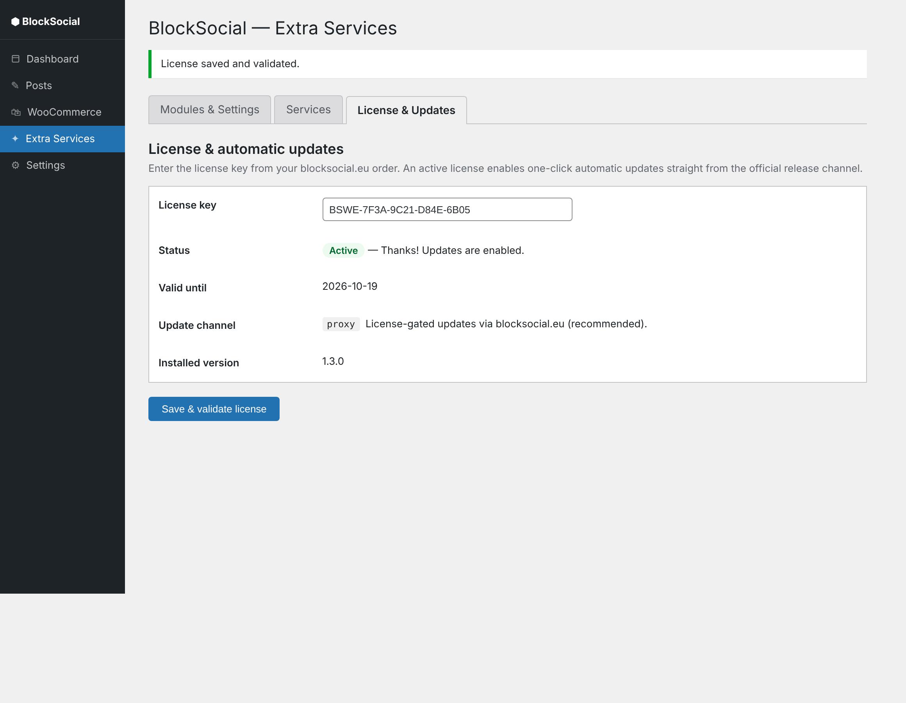
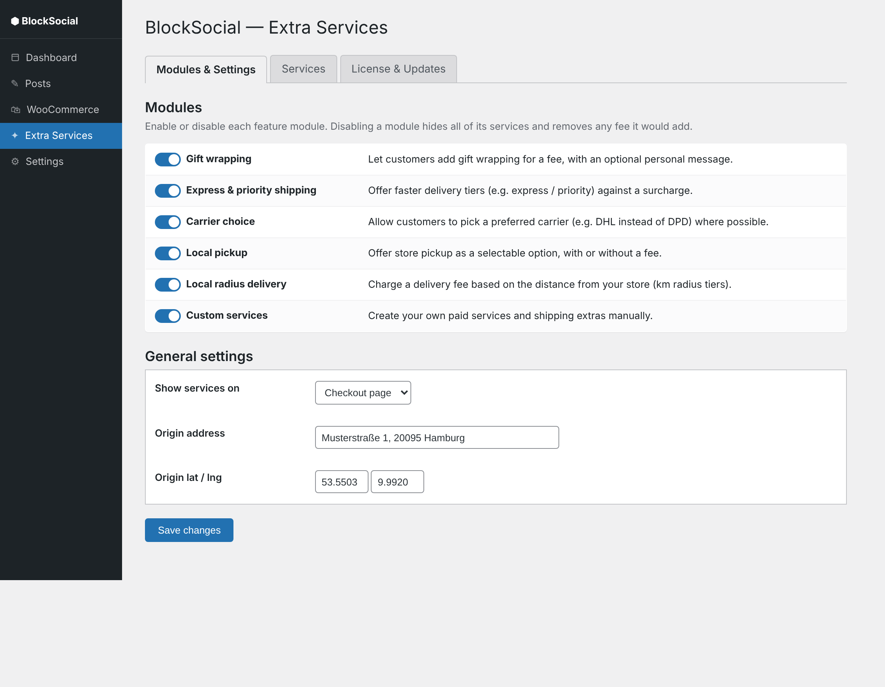
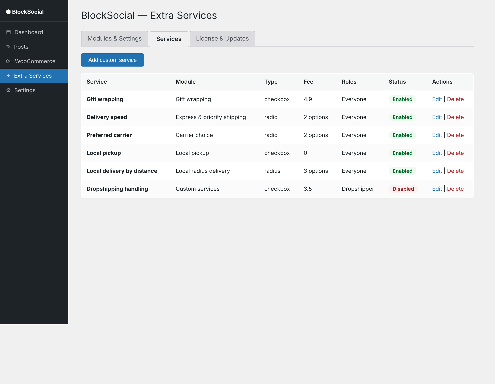
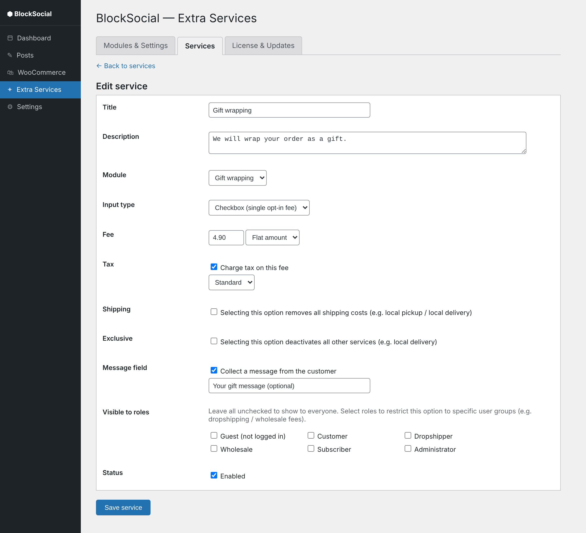
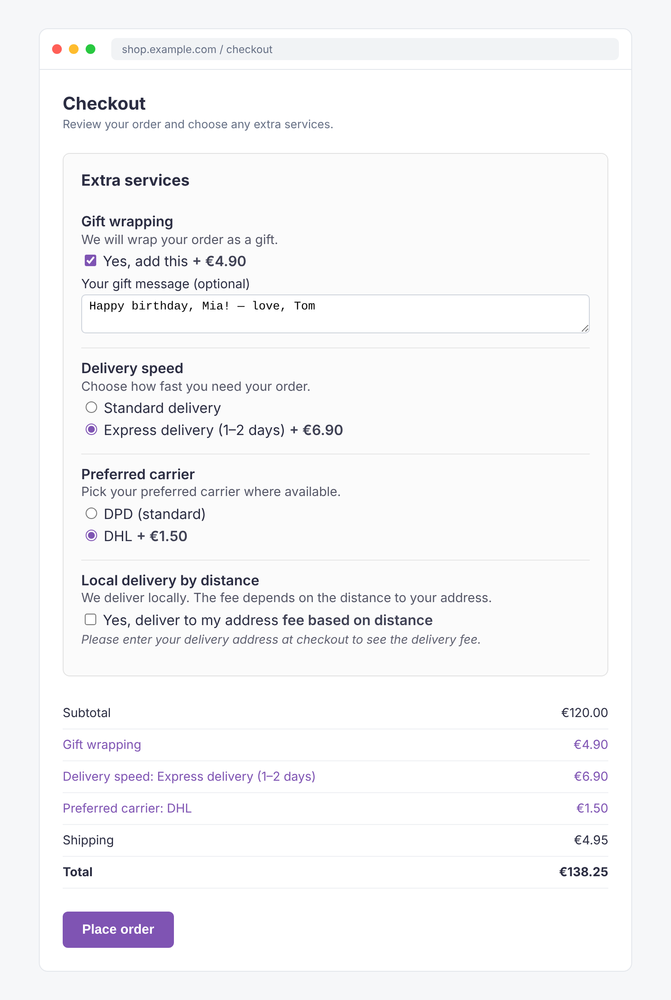

# Bedienungsanleitung — BlockSocial WooCommerce Extra Services

> Kostenpflichtige Versand- und Serviceoptionen für WooCommerce.
> Ein Produkt von **BlockSocial UG (haftungsbeschränkt)** · [blocksocial.eu](https://blocksocial.eu)

Diese Anleitung führt dich von der Installation bis zur fertig konfigurierten
Kasse. Lesezeit ca. 10 Minuten.

---

## Inhalt

1. [Installation & Aktivierung](#1-installation--aktivierung)
2. [Lizenz & automatische Updates](#2-lizenz--automatische-updates)
3. [Module aktivieren](#3-module-aktivieren)
4. [Allgemeine Einstellungen](#4-allgemeine-einstellungen)
5. [Services bearbeiten & anlegen](#5-services-bearbeiten--anlegen)
6. [Benutzergruppen / Dropshipping-Gebühren](#6-benutzergruppen--dropshipping-gebühren)
7. [Umkreislieferung einrichten](#7-umkreislieferung-einrichten)
8. [So sieht es an der Kasse aus](#8-so-sieht-es-an-der-kasse-aus)
9. [Rechnungen (Germanized)](#9-rechnungen-germanized)
10. [FAQ & Fehlerbehebung](#10-faq--fehlerbehebung)

---

## 1. Installation & Aktivierung

1. **Plugins → Installieren → Plugin hochladen** öffnen.
2. Die Datei `blocksocial-woo-services-x.y.z.zip` auswählen → **Jetzt installieren**.
3. **Aktivieren**. WooCommerce muss installiert und aktiv sein.
4. Danach erscheint links im Menü unter **WooCommerce → Extra Services** die
   Konfiguration. Beim ersten Aktivieren werden sinnvolle Standardmodule und
   -services angelegt.

> Voraussetzungen: WordPress 6.0+, WooCommerce 6.0+, PHP 7.4+. HPOS wird
> unterstützt.

---

## 2. Lizenz & automatische Updates

Damit dein Shop automatische Updates erhält, trage den Lizenzschlüssel aus
deiner Bestellung ein: **WooCommerce → Extra Services → License & Updates**.

- **License key**: der Schlüssel aus deiner blocksocial.eu-Bestellung.
- **Save & validate license** klicken. Bei gültiger Lizenz steht der Status auf
  **Active** – ab sofort werden neue Versionen wie jedes andere Plugin direkt
  unter **Plugins** zum Update angeboten (ein Klick, kein manuelles Hochladen).

> Ohne gültige Lizenz funktioniert das Plugin unverändert weiter – es erhält nur
> keine automatischen Updates.

---

## 3. Module aktivieren

Jede Funktion ist ein eigenes Modul und lässt sich einzeln an- und abschalten.
Ein deaktiviertes Modul blendet seine Services aus und entfernt jede Gebühr, die
es berechnen würde.

| Modul | Funktion |
| --- | --- |
| **Gift wrapping** | Geschenkverpackung gegen Gebühr, optional mit Nachricht |
| **Express & priority shipping** | Schnellere Lieferstufen gegen Aufpreis |
| **Carrier choice** | Wunsch-Versanddienstleister (z. B. DHL statt DPD) |
| **Local pickup** | Abholung, mit oder ohne Gebühr; setzt den Versand auf 0 |
| **Local radius delivery** | Liefergebühr nach Entfernung (km-Stufen) |
| **Custom services** | Eigene Services frei anlegen |

Nach Änderungen unten **Save changes** klicken.

---

## 4. Allgemeine Einstellungen

Im selben Tab unter **General settings**:

- **Show services on** – Warenkorb, Kasse oder beides.
- **Origin address / lat / lng** – Standort deines Geschäfts für die
  Umkreislieferung (Koordinaten sind am zuverlässigsten).

---

## 5. Services bearbeiten & anlegen

Der Tab **Services** listet alle Optionen. Über **Add custom service** legst du
eigene an; **Edit** öffnet den Editor.

Im Editor stellst du alles pro Service ein:

- **Title / Description** – was der Kunde sieht.
- **Input type** – *Checkbox* (einmalige Gebühr), *Choice* (Auswahl mit mehreren
  Optionen) oder *Distance tiers* (Umkreis).
- **Fee / Fee type** – fester Betrag, Prozent der Zwischensumme oder pro Artikel.
  Negative Werte wirken als Rabatt.
- **Tax** – steuerpflichtig ja/nein und Steuerklasse.
- **Shipping** – „removes all shipping costs": bei Auswahl werden die
  Versandkosten auf 0 gesetzt (für Abholung / lokale Lieferung).
- **Exclusive** – bei Auswahl werden alle anderen Services deaktiviert.
- **Message field** – Freitextfeld vom Kunden (z. B. Geschenktext).
- **Visible to roles** – Sichtbarkeit pro Benutzergruppe (siehe nächster Punkt).
- **Status** – aktiv/inaktiv.

---

## 6. Benutzergruppen / Dropshipping-Gebühren

Jeder Service kann auf bestimmte WordPress-Rollen beschränkt werden
(**Visible to roles**). Ohne Auswahl sehen alle die Option.

**Beispiel Dropshipping-Gebühr:** Lege einen Custom Service „Dropshipping
handling" mit der gewünschten Gebühr an und hake nur die Rolle *Dropshipper* an.
Nur eingeloggte Nutzer dieser Rolle sehen und zahlen die Gebühr. Gäste erreichst
du über die virtuelle Rolle *Guest (not logged in)*.

---

## 7. Umkreislieferung einrichten

1. Modul **Local radius delivery** aktivieren.
2. Unter **General settings** den Store-Standort hinterlegen (Koordinaten
   empfohlen).
3. Im Service **Local delivery by distance** die Stufen pflegen, z. B.
   bis 5 km → 2,90 €, bis 10 km → 4,90 €, bis 20 km → 8,90 €.

Die Gebühr richtet sich nach der Entfernung von deinem Standort zur
Lieferadresse. Der Service ist standardmäßig **exklusiv** und **versandkostenfrei
** – bei Auswahl entfallen die normalen Versandkosten und andere Services werden
deaktiviert. Ein Hinweis fordert den Kunden auf, zuerst seine Adresse einzugeben.

---

## 8. So sieht es an der Kasse aus

Kundinnen und Kunden wählen die Extras direkt im Warenkorb oder an der Kasse; die
Beträge erscheinen sofort in der Bestellsumme.

---

## 9. Rechnungen (Germanized)

Jede Gebühr wird als echte Bestellposition angelegt und erscheint damit
automatisch auf Rechnungen – auch auf denen von WooCommerce Germanized (inkl.
Germanized Pro PDF-Rechnungen). Eine Kundennachricht (z. B. Geschenktext) wird als
sichtbares Positions-Meta direkt unter der Gebühr ausgegeben.

---

## 10. FAQ & Fehlerbehebung

**Die Extras erscheinen nicht an der Kasse.**
Prüfe, ob das jeweilige Modul aktiv ist, der Service auf *Enabled* steht und —
falls Rollen gesetzt sind — der eingeloggte Nutzer die passende Rolle hat.

**Die Umkreisgebühr wird nicht berechnet.**
Store-Koordinaten hinterlegen (zuverlässiger als Adresse) und sicherstellen, dass
die Lieferadresse geokodiert werden kann. Schlägt die Entfernungsermittlung fehl,
wird bewusst keine Gebühr berechnet (der Checkout wird nie blockiert).

**Mehrsprachig.** Das Plugin folgt der WordPress-Sprache. Deutsch, Französisch
und Italienisch sind enthalten; weitere Sprachen über `languages/bwes.pot`.

**Kein automatisches Update.** Lizenzstatus unter *License & Updates* prüfen
(muss *Active* sein) und ob der Server blocksocial.eu erreichbar ist.

---

© 2026 BlockSocial UG (haftungsbeschränkt) · Support: support@blocksocial.eu
